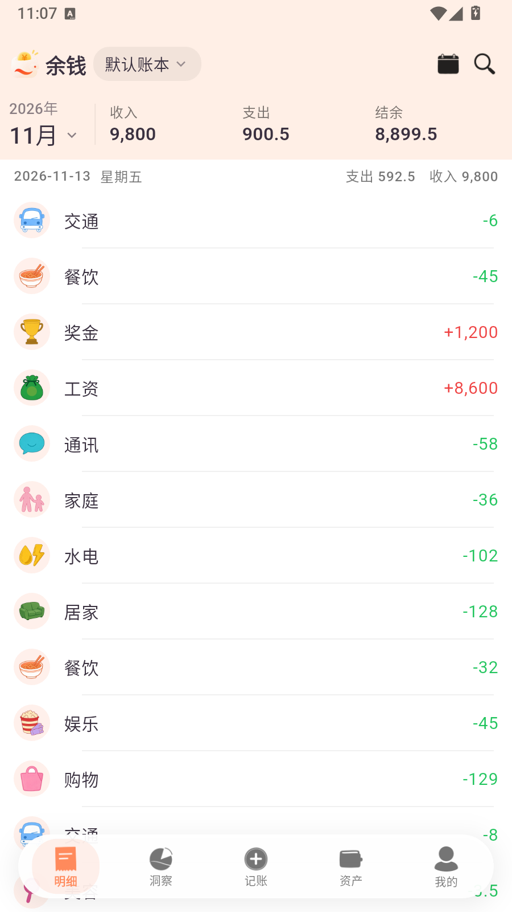
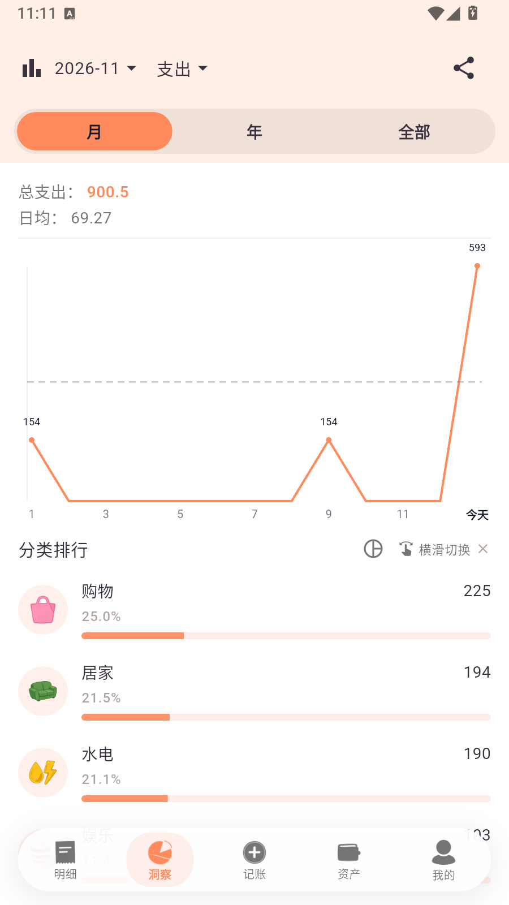
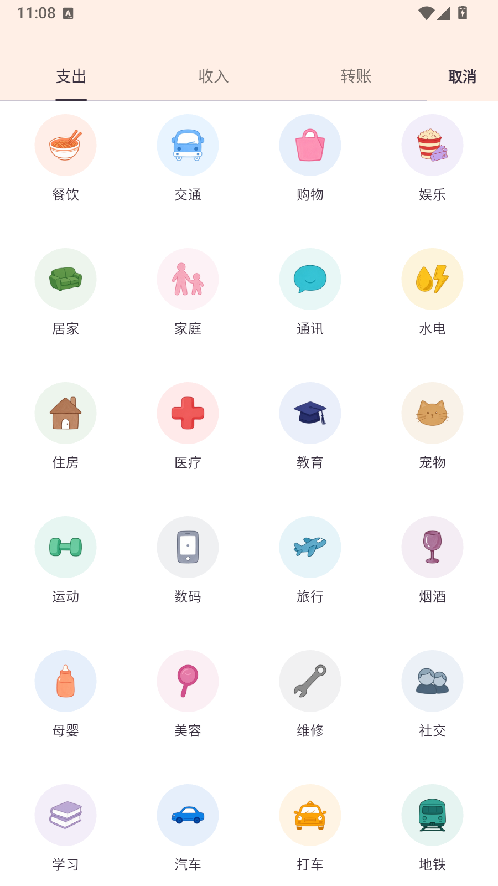
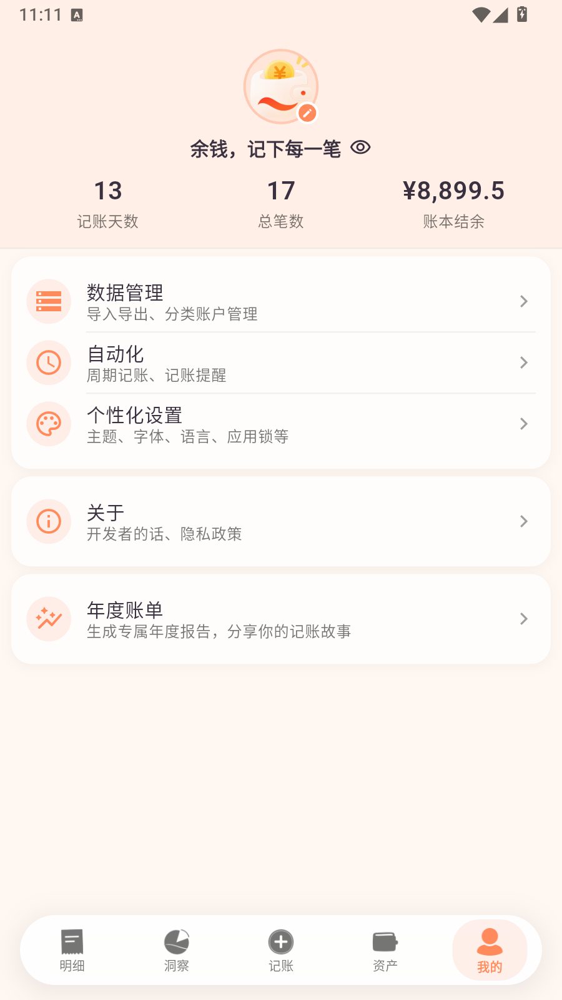

<p align="center">
  
</p>

# 余钱 · 记账 App

一个**只做本地记账**的 Android 记账应用。在原开源项目 [BeeCount](https://github.com/TNT-Likely/BeeCount)（BSL 1.1 许可）的基础上做了大幅精简与重做视觉，去掉了一切联网、云同步、AI、社交和运营类功能，只留下记账本身。

- 安装包体积：**约 45 MB**（三 ABI 通用包，原版约 45.8 MB，精简后小一截）
- 网络请求：**零**。没有云同步、没有统计上报、没有广告、没有检查更新
- 数据存放：本机 SQLite（文件 `beecount.sqlite`，目录保留原命名以兼容旧数据）

---

## 截图

| 明细（首页） | 洞察 | 记账 |
|---|---|---|
|  |  |  |

| 我的 | 关于 |
|---|---|
|  |  |

> 截图取自 900×1600 / Android 14 环境实拍，账目为演示数据。桌面图标、启动页与分类图标为 190 张手绘贴纸风 WebP。

---

## 现在保留什么

| 模块 | 说明 |
|---|---|
| 明细 | 支出 / 收入 / 转账 / 余额校准，日/周/月切换，搜索、筛选、批量操作 |
| 记账 | 手写数字键盘、分类宫格、账户/标签/日期/备注、多币种 |
| 资产 | 多账本、多账户（现金/银行卡/信用卡/投资/贷款/房产/车辆/保险/公积金等）、账户间转账、余额趋势 |
| 洞察 | 分类占比、收支趋势、预算进度、周期对比 |
| 统计 | 分类/账户/标签维度统计，时间区间与自定义维度 |
| 周期记账 | 唯一保留的自动化：到点自动生成账目（本地调度，不联网） |
| 年度账单 | 年度回顾 + 可分享长图（纯本地生成） |
| 分类/标签管理 | 图标、排序、导入导出、自定义分类包 |
| 数据管理 | CSV / ZIP 导入导出、附件管理、配置导入导出、孤立文件清理 |
| 小组件 | Android 桌面组件（Flutter 渲染成图，无后台服务） |
| 备份 | 手动导出，无云端备份 |

## 去掉什么（相对原版）

云同步（BeeCount Cloud / Supabase / WebDAV / S3 / iCloud）、AI 智能记账与 AI 助手、语音记账、拍照记账、相册/截图记账、共享账本与成员管理、邀请码、给项目点 Star、分享应用、复制推广文案、支持我们（内购打赏）、检查更新、使用帮助（在线文档）、姐妹产品推广（BeeAssets / BeeDNS）、主题商店里的运营位、隐私政策在线页（改为本地纯文本）。

> 这些不是"藏起来"，是把页面代码一起删了；`flutter analyze` 无 error。

## 视觉

- **App 图标 / 启动页 / 品牌标**：暖橙渐变元宝钱包（自绘抠图重建），启动页纯色 `#FF8A5C`
- **分类图标**：190 张手绘贴纸风图标（支出 101 + 收入 40 + 子类），256px **WebP**（有损 q90 + alpha 无损）
- **账户/工具栏/引导页图标**：同风格贴纸，同样 WebP
- **字体**：系统字体（不打包中文字体，省 12 MB）
- **品牌名**：余钱（Android 四语言 `app_name`；文案里统一替换）

品牌图标见 `docs/brand/`：`logo-source.png`（设计原稿 1254×1254）、`logo.png`（512×512）、`logo-216.png`（216×216）。

## 技术栈

Flutter 3.27 / Dart 3 · Drift(SQLite) · Riverpod · fl_chart · home_widget · flutter_localizations（4 语言：zh / zh_TW / en / ko）

## 构建

```bash
# 环境：Flutter 3.27.x、JDK 21、Android SDK 35
flutter pub get
flutter gen-l10n                     # 改过 lib/l10n/*.arb 后必须跑
flutter build apk --release --flavor prod
# 产物：build/app/outputs/flutter-apk/app-prod-release.apk
```

要点：

1. **必须带 `--flavor prod`**，否则 Gradle 找不到目标。
2. 签名配置在 `android/key.properties`（不在仓库里），字段 `storeFile / storePassword / keyAlias / keyPassword`；没有它 Gradle 会退回 debug 签名。
3. `android/gradle.properties` 里若有指向 `127.0.0.1:xxxx` 的代理，记得注释掉，否则 R8 会卡住。
4. 换图标资源后请 `flutter clean` 再打包——`build/flutter_assets` 是增量的，删掉的文件还会被打进去。

## 目录

```
lib/                 Flutter 源码（pages/widgets/providers/services/data/styles）
packages/            本地 path 依赖（agentcore、flutter_cloud_sync* 等，保留编译壳）
assets/              WebP 图标、品牌图、启动图、主题皮肤
android/             Android 工程（含 prod/dev flavor、自适应图标、5 密度资源）
ios/                 iOS 工程（未维护，仅供工程完整性）
l10n.yaml            多语言生成配置
```

## 许可与致谢

本仓库是基于 [BeeCount](https://github.com/TNT-Likely/BeeCount) 的改造版本，沿用其 **Business Source License 1.1**（见 `LICENSE`），仅作个人自用，不用于商业分发。原项目的分类体系、数据模型与大量业务代码来自上游作者，特此致谢。移除的商业授权说明见 `COMMERCIAL_LICENSE.md`。

**本仓库不含**：签名密钥、`key.properties`、构建产物、上游 CI 配置、演示与官网素材、测试用例（原测试针对已被移除的云同步/AI 模块，保留会误导）。
